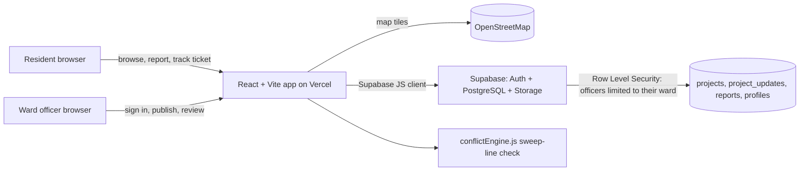

# CivicWorks — Public works, made visible

> **Hackathon track:** CivicTech — *Improving Transparency and Coordination in Public Works Projects*
> **IIITDM Kancheepuram 24-hour Web Development Hackathon**

| | |
|---|---|
| **Team Name** |Segmentation Fault|
| **Live demo** |https://civicworks-hackathon-team.github.io/civicworks-hackathon/ |
| **Demo video (2–5 min)** | https://drive.google.com/file/d/1_hwirQDELQebjT7pLqwjwm10ao0IoGZW/view?usp=sharing |
| **Team** |Yasovardhan ,Sai Teja,Srihari,Pranav Sai Samhit |

## The problem

Residents see roads dug up, drains opened and pipes laid every day, but the information is scattered across offices and notice boards. Residents cannot tell the purpose, timeline, contractor or responsible authority of a project, or why it is delayed. Departments often work without knowing what others have planned, so the same road can be dug up several times in a few months, and nobody is easily held accountable when work stalls.

## Our solution

CivicWorks gives residents one public place to see nearby works, and gives ward officers one place to publish them and close the loop on complaints:

- **Citizens:** map + list of works near them, timelines, contractor, budget disclosure, safety notices, and ticketed hazard/delay reports with status tracking.
- **Officers:** a ward-scoped workspace to publish project records and respond to reports.
- **Inter-department coordination:** an engine that warns when works by *different* departments overlap in time and are close together (see below).

## Architecture



If Supabase is not configured, the app runs in **demo mode** with clearly labelled sample data in browser storage.

## Coordination engine (algorithm)

Source: [`src/conflictEngine.js`](src/conflictEngine.js), tests: [`tests/conflictEngine.test.js`](tests/conflictEngine.test.js) (`npm test`), plus [`tests/utils.test.js`](tests/utils.test.js) for the status, ward, validation and throttle rules.

1. Each project's work window is its actual dates if recorded, otherwise its planned dates. Projects with missing or invalid dates are skipped, not guessed.
2. Windows are **sorted by start date** and swept left to right, keeping an *active* list of windows that have not ended. Every window still active when a new one starts overlaps it in time.
3. Each overlapping pair is then filtered: **different departments**, not both completed, and within **350 m** (Haversine distance).
4. Pairs within **150 m** are labelled *likely same stretch*; the rest *adjacent corridor*.

**Complexity:** `O(n log n + k)` time, where `k` is the number of pairs that overlap in time (sorting plus one visit per overlapping pair), and `O(n)` space. A naive all-pairs comparison is `O(n²)` however few projects actually overlap.

**Limitations (stated honestly):** projects store a single point, not a road geometry, so the engine cannot prove two works are on the same road segment. Its output is a **warning for officers to verify**, and the UI says so. The sweep runs on the projects inside the user's selected search radius.

A mobile-friendly CivicTech prototype for tracking construction and repair work by ward. It brings together planned, ongoing, delayed and completed work, geofenced discovery, resident impacts and safety notices, cost/material disclosure, officer-published progress updates, and resident report tracking.

## What is included

- **Nearby public-works map:** uses the browser's location permission; draws a selectable radius (1, 3, 5, 10, 25 or 50 km) and shows project markers inside that radius.
- **Public project records:** timelines, current status, progress, planned/actual start and finish dates, published daily work hours, department, ward, contractor, responsible officer, estimated cost, reported spending, materials, quality notes, affected residents, temporary impacts, safety notes, traffic/access plan, update history and source label.
- **Automatic delay detection:** planned or ongoing work that is past its planned finish date, with no actual finish recorded, is shown as *Delayed* with an explanatory reason. The officer's recorded status is never overwritten.
- **Past / current / planned work timeline:** grouped into upcoming, ongoing/delayed and completed work.
- **Resident reports:** submit a hazard, delay or quality issue with an optional photo (JPG/PNG/WebP, up to 2 MB), receive a ticket code, then check its status and any authority response. In connected mode, photo evidence is kept in a private storage bucket accessible to officers.
- **Officer workspace:** create/edit project records, review/resolve reports and view uploaded evidence.
- **Secure backend option:** Supabase Auth + PostgreSQL Row Level Security. In connected mode, officers can edit only the ward assigned to their profile; admins can edit all wards. These permissions are enforced in the database, not just in the interface.
- **Department coordination warning:** flags work from different departments that is within 350 metres and has overlapping date ranges. It asks officers to verify the actual road segment; it is not proof of a conflict.
- **Demo mode:** if Supabase isn't configured, the app works with clearly labelled sample data stored in the current browser's local storage. It is for testing only and is not a secure multi-user system.

## Important notes before showing it as a real civic service

1. The sample projects and coordinates are **fictional demo records** clustered near IIITDM Kancheepuram so the map is populated for a hackathon demo. They are not verified public works and must not be represented as real government records.
2. The default map centre is a demo location. Click **Use my live location** and allow the browser permission to centre the map on the user's actual location. The coordinates are kept in browser memory and are not saved to the backend by this app.
3. Geolocation usually works on `localhost` during development and on an HTTPS website after deployment. It may not work on a plain HTTP public URL.
4. The dashed circle is a user-selected search radius, not an official ward boundary. This first version filters project points by distance from the user's current location; it does not use a polygon/GIS boundary file.
5. An officer should publish only information backed by an approved ward record/work order. Mark costs as undisclosed where the authority has not released them, rather than guessing.
6. Real officers must use individually assigned accounts. Do not share a single officer password with a ward/team.

## Run it on your laptop (demo mode)

You do not need a database to try the sample prototype.

1. Install **Node.js LTS** from <https://nodejs.org/>.
2. Clone the repository and open the folder in VS Code (**Terminal → New Terminal**):

   ```bash
   git clone https://github.com/YOUR-USERNAME/YOUR-REPO.git
   cd YOUR-REPO
   npm install
   npm run dev
   ```

3. Optional: run the engine tests with `npm test`.
4. Open the local URL Vite prints (normally `http://localhost:5173`).
5. Click **Try officer demo** to test project editing and report management. Changes are stored only in that browser. Click **Reset sample data** to restore the examples.

If `npm` is not recognized, close and reopen VS Code after installing Node.js, then try again.

## Connect the real shared database (Supabase)

Do this when you're ready for officers and residents to see the same records. The local demo mode is **not** safe for real official data.

1. Create a project at <https://supabase.com/>.
2. In Supabase, open **SQL Editor → New query**, paste all of [`supabase/schema.sql`](supabase/schema.sql), and run it. This creates the tables, permissions, report lookup function and the profile trigger.
3. In **Project Settings → API**, copy the Project URL and the **anon/public** key. Do not copy the `service_role` key into the website.
4. In the `civicworks` project folder, copy `.env.example` to `.env.local` and add the values:

   ```dotenv
   VITE_SUPABASE_URL=https://YOUR_PROJECT.supabase.co
   VITE_SUPABASE_ANON_KEY=YOUR_SUPABASE_ANON_KEY
   ```

5. Stop the development server (`Ctrl+C`) and start it again with `npm run dev`. With both environment variables present, the app switches to Supabase mode.
6. In Supabase **Authentication → Users**, invite/create the official's account. Public residents should not be given officer credentials. After the account is created, run a role assignment in SQL Editor (replace the sample values). Use the exact same ward label in both the officer profile and project records:

   ```sql
   update public.profiles
   set role = 'officer', full_name = 'Ward Officer Name', ward = 'Ward 12'
   where id = (
     select id from auth.users
     where email = 'officer@example.gov.in'
   );
   ```

   Only set `role = 'officer'` for verified officials, and use the exact ward label used by the project records (for example `Ward 12`). Ward-level Row Level Security means that officer can edit projects, review reports and view photo evidence only for the assigned ward; an admin can manage all wards. Use `role = 'admin'` only for a trusted system administrator.
7. Sign in through **Officer sign in**. A normal resident account can sign in but cannot publish or edit projects unless its profile has an officer/admin role. Residents pick their ward from a list built from published projects (the database also rejects a report whose ward has no published works, so a typo can never hide a report from officers); a report linked to an existing project inherits that project's ward. If you set up the database before this change, re-run `supabase/schema.sql`.

### Before real-world use

- Replace all demo entries with verified project records and real work-site coordinates.
- Confirm that the responsible department permits publication of the contractor, budget, spend and officer details shown.
- Add a controlled admin process for inviting/revoking officer accounts, plus audit/export features, backups, a privacy notice, server-side rate limits (the ticket lookup is only throttled in the browser, 5 tries a minute) and moderation/abuse controls. Ward-specific project/report permissions and private photo storage are included in the starter schema.
- Configure Supabase Auth allowed URLs for your development and deployed URLs.
- Review the SQL and privacy design with the relevant authority before collecting personal contact details. Reports do not expose contact details or private image paths through the public ticket lookup.

## Deploy it as a public website

A straightforward option for this Vite app is **Vercel** or **Netlify**:

1. Create a GitHub repository and upload the contents of this folder (not `node_modules`).
2. Import the repository into Vercel/Netlify.
3. Set the build command to `npm run build` and output directory to `dist`.
4. Add `VITE_SUPABASE_URL` and `VITE_SUPABASE_ANON_KEY` in the hosting provider's environment-variable settings. Don't add `.env.local` to GitHub.
5. Deploy, then add the deployed website URL to Supabase Auth's allowed redirect/site URL settings.
6. Open the deployed HTTPS URL on a phone and test location permission, the radius selector, resident report submission, officer login, project updates and ticket lookup.

A public hosting link makes the demo accessible to judges, but the Supabase setup is what makes data shared and officer edits protected.

## Feature coverage checklist

| Need | Included |
|---|---|
| Start/finish dates and progress | Planned/actual start & finish, progress, updates |
| Temporary impact and safety hazards | Affected groups, impacts, safety notices, traffic/access plan |
| Transparency | Estimate, reported spend, materials, quality notes, contractor, responsible officer, source label |
| Department ownership | Department and ward fields |
| Past / ongoing / future | Timeline groups and status filters |
| Resident feedback | Ticketed report form and authority response/status tracking |
| Nearby location-based discovery | Browser geolocation, radius selector, map circle and markers |
| Officer-only editing | Supabase Auth + RLS (when configured); local-only demo mode otherwise |
| Department coordination | Flags nearby work from different departments with overlapping dates for human verification |

## Stack

- React + Vite
- Leaflet + OpenStreetMap tiles
- Supabase Auth + PostgreSQL + Row Level Security (optional backend for the demo, required for shared/secure records)

## Open-source libraries and services used (disclosure)

| Library / service | Purpose |
|---|---|
| React, React DOM | UI |
| Vite, @vitejs/plugin-react | Build tooling and dev server |
| Leaflet, react-leaflet | Interactive map |
| lucide-react | Icons |
| @supabase/supabase-js | Optional backend client (Auth, PostgreSQL, Storage) |
| OpenStreetMap | Map tiles and data (see attribution below) |
| Google Fonts (DM Sans, Manrope) | Typography |
| Node.js built-in test runner | Engine tests |

All dependencies are listed with exact versions in `package.json` / `package-lock.json`.

## AI-assistance disclosure

*(Team: fill this in accurately, for example which AI tools were used and for what, and confirm it matches the organisers' rules.)*

## License / data attribution

Map tiles and map data are provided by OpenStreetMap contributors. See <https://www.openstreetmap.org/copyright>. Use of the underlying service is subject to OpenStreetMap's tile usage policy.

## Code layout

`src/App.jsx` holds state and data access; `src/components/` has the pages and modals; `src/utils.js` and `src/db.js` hold the pure helpers and database mapping; `src/conflictEngine.js` is the coordination algorithm.
